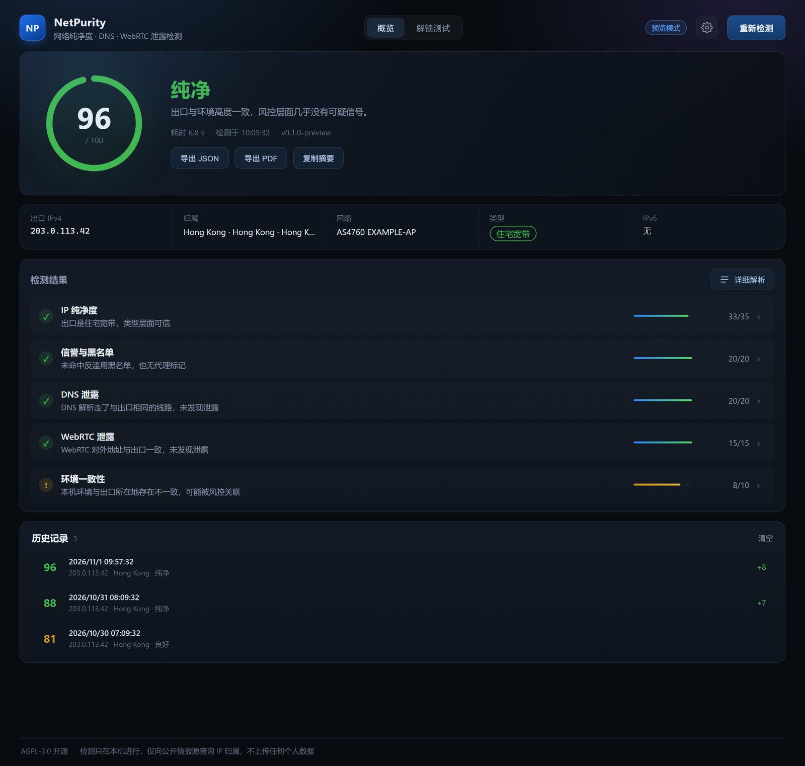
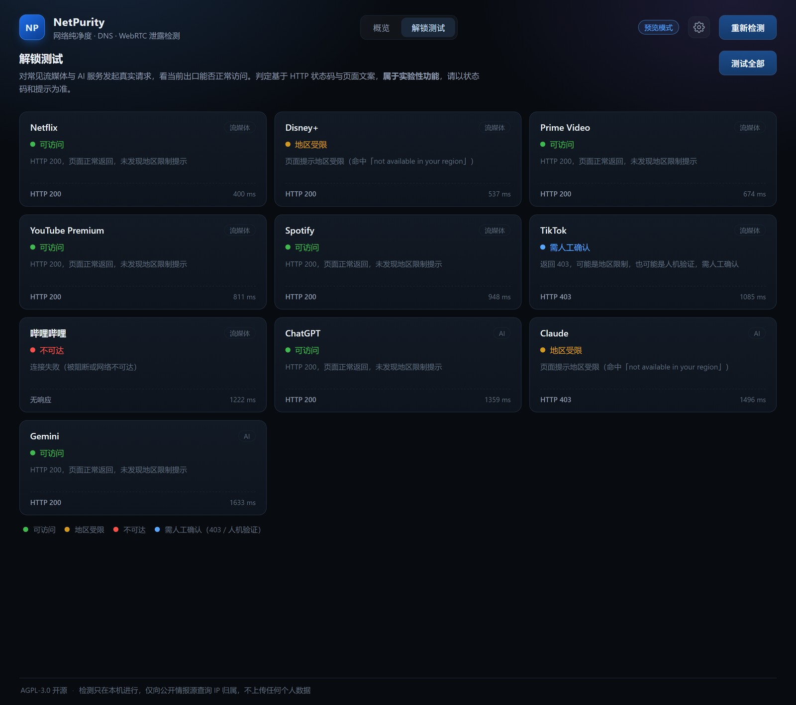

# NetPurity · 网络纯净度检测

一个开源的 Windows 桌面工具，从**风控视角**检查你当前的出口 IP 是否可信，以及 DNS、WebRTC、时区环境有没有把真实位置漏出去。

不收费、不做用户体系、不上传检测数据。



## 下载

到 [Releases](https://github.com/szmv-16/netpurity/releases) 下载 `NetPurity-<版本>-win64.zip`，解压后双击 `NetPurity.exe` 即可。

绿色免安装，删掉文件夹就是卸载。当前提供 Windows x64 版本。

## 功能

- **概览**：一键检测，五项结论以精简列表呈现，点任意一行或「详细解析」看完整证据链
- **解锁测试**：对 Netflix / Disney+ / ChatGPT / Claude 等 10 个服务发起真实请求，看当前出口能否访问
- **设置**：深色 / 浅色 / 跟随系统、情报源公示、版本信息
- **报告**：导出 JSON / PDF、复制文字摘要
- **历史**：最近 50 次检测自动保存，可回看并对比分数变化



## 它检测什么

| 模块 | 检测内容 | 满分 |
| --- | --- | --- |
| 出口 IP | 5 个探测源交叉验证，识别透明代理 / 分流出不同出口 | — |
| IP 纯净度 | 住宅 / 移动 / 机房 / 代理类型、ASN 归属、PTR、原生性 | 35 |
| 信誉与黑名单 | 4 个公开 DNSBL、代理 / VPN / 托管标记 | 20 |
| DNS 泄露 | 递归解析器出口 IP 与代理出口是否同一网络 | 20 |
| WebRTC 泄露 | 浏览器 UDP 是否绕过代理、内网地址、IPv6 候选 | 15 |
| 环境一致性 | 时区、语言地区与出口所在地是否自洽 | 10 |

总分 100，四档：90+ 纯净 / 70–89 良好 / 55–69 一般 / <55 高风险。**跳过的检测项不计入分母**，避免「没测到」被算成安全。

## 判定原理

**DNS 泄露**：很多权威 DNS 会把「递归解析器的出口地址」回显在应答里（`o-o.myaddr.l.google.com`、`whoami.akamai.net`、`whoami.ds.akahelp.net`）。查询这些名字，就能知道你真实的 DNS 解析是从哪个网络出去的，再与代理出口的 ASN / 国家比对：

- 同 ASN → 解析走了代理，安全
- 不同国家 → 解析没走代理，**泄露**
- 公共 DNS（1.1.1.1 / 8.8.8.8）→ 未暴露 ISP，但暴露区域

这种方式不需要自建服务器。后续会加一台自建权威 DNS 做更精确的验证（见路线图）。

**WebRTC**：在渲染进程建立 `RTCPeerConnection`，收集 ICE 候选，看 `srflx`（STUN 反射出的公网地址）是否等于 HTTP 出口 IP。不一致就说明浏览器 UDP 流量绕过了代理。

**IP 纯净度**：ipwho.is 提供地理与 ASN，ip-api 提供 `proxy` / `hosting` / `mobile` 标记，再用内置的机房 ASN 表和名称特征做兜底判断。三个来源投票，不依赖单一库。

**解锁测试**：对目标服务发起真实 HTTP 请求，检查状态码与页面里的地区限制文案。没有平台会提供官方接口，所以这是启发式判定，界面上会如实标注「需人工确认」。

## 快速开始

需要 Node.js 20 以上（22 LTS 与 26 均已验证）。

```bash
npm i -g pnpm      # 如果还没有 pnpm
pnpm install
pnpm dev           # 开发模式，改代码热更新
```

界面右上角可以导出 JSON / PDF 报告、复制文字摘要；每次检测会自动存进本机历史（最近 50 条，存在 `%APPDATA%/netpurity/history.json`），点历史条目可以回看当时的完整结果。

打包成 Windows 可执行文件：

```bash
pnpm dist                    # 同时产出安装版和便携版
pnpm dist -- --win portable  # 只出便携版
```

产物在 `dist/`：

- `NetPurity-<版本>-setup.exe` — NSIS 安装包，可选安装目录，创建桌面 / 开始菜单快捷方式
- `NetPurity-<版本>-portable.exe` — 单文件免安装，运行时解压到临时目录
- `win-unpacked/` — 免解压目录版，最不容易被安全软件拦截

> 打包机需要能**正常执行 GUI 程序**：electron-builder 生成卸载程序时会运行一次临时安装包，纯命令行 / 无桌面会话（CI 容器、远程会话）会卡在这一步。遇到时改用 `--win portable`，或换一台有桌面的机器打包。

如果便携版的自解压被安全软件拦住（报 `Error writing temporary file`），改用目录版：

```powershell
Compress-Archive -Path dist\win-unpacked\* -DestinationPath dist\NetPurity-win64.zip -Force
```

> 别用 `tar -a -c -f` 生成 zip：bsdtar 写出来的归档 libarchive 能读、Windows 资源管理器会报「文件无效」。

命令行直接跑一次检测（不需要开界面，适合服务器巡检）：

```bash
pnpm cli          # 人类可读报告
pnpm cli --json   # JSON 输出
```

只想看界面（浏览器里用内置样例数据，不连网络）：

```bash
pnpm preview:ui   # 打开 http://127.0.0.1:5178
```

## 目录结构

```
electron/            Electron 主进程与 preload
  main.ts            IPC、窗口、扫描调度
  preload.ts         暴露给前端的受限 API
  history.ts         本地历史记录（JSON 文件）
src/core/            纯 TypeScript 检测引擎（不依赖 Electron，可单独复用）
  probes/exit-ip.ts  多源出口探测
  probes/ip-intel.ts 情报聚合（ipwho.is + ip-api + ipapi.co 兜底）
  probes/blacklist.ts DNSBL 黑名单
  probes/dns.ts      解析器回声、NXDOMAIN 劫持、DoH 比对
  probes/webrtc.ts   WebRTC 候选判定
  probes/consistency.ts 时区 / 语言一致性
  probes/unlock.ts   解锁 / 可达性测试
  weights.ts         权重与评级
  engine.ts          编排与总分
src/renderer/        React 界面
  components/        ScoreRing / CheckCard / SummaryRow / 弹层
cli.ts               命令行入口
scripts/             预览服务器（截图 / 设计评审用）
.github/workflows/   打 tag 自动构建并发布 Release
```

检测引擎与界面完全解耦：`src/core` 只依赖 Node 标准库，可以嵌进自己的项目。

## 隐私

- 所有检测在本机完成，**不上传任何检测结果**。
- 只向公开情报源查询 IP 归属：ipwho.is、ip-api.com、Cloudflare DoH、Google/Akamai 权威 DNS、各 DNSBL。
- 会读取本机网卡、DNS 服务器、系统代理配置——这些只用于本地判定，不外发。
- 不收集使用统计，不接入任何分析 SDK。
- 本地只写两个文件：启动日志 `%TEMP%\netpurity\boot.log` 和历史记录 `%APPDATA%\netpurity\history.json`。

## 已知限制

- **加密 DNS（DoH/DoT）**：系统开启 DoH 时，传统 DNS 探测拿不到解析器出口，DNS 项会显示「跳过」而不是给假结论。
- **代理的 fake-ip 模式**：部分代理软件会劫持所有域名解析，同样会导致 DNS 项无法观测。
- **WebRTC mDNS**：Chrome/Edge 默认用 `.local` 隐藏内网 IP，这是隐私保护，不是泄露。
- **情报源精度**：免费源对「住宅 vs 机房」的判定会有误差，尤其是被大量转售的 IP 段。工具展示每个源的原始结论，不掩盖分歧。
- **解锁测试是启发式的**：未登录、人机验证、A/B 页面都会影响结果，界面上会如实标注「需人工确认」。

## 常见问题

**双击 exe 没反应 / 报 `Error writing temporary file`**

便携版启动时要把自己解压到 `%TEMP%`，常被安全软件拦。改用 zip 绿色版，解压后直接跑 `NetPurity.exe`。

**提示「Windows 已保护你的电脑」**

程序没有购买代码签名证书，属于正常现象。点「更多信息」→「仍要运行」即可；源码完全公开，可以自行审计或编译。

**进程在跑但看不到窗口**

看 `%TEMP%\netpurity\boot.log`，里面记录了启动到哪一步。程序内置了 1.5 秒强制显示兜底，如果仍不显示，多半是显卡驱动或安全软件问题，把该文件贴到 Issue 里。

**DNS 项显示「跳过」**

说明系统启用了加密 DNS（DoH/DoT），或代理开了 fake-ip 模式——这两种情况下传统 DNS 探测拿不到解析器出口。跳过比给假结论更诚实。

## 路线图

- [x] M0 检测引擎 + 桌面界面 + 评分
- [x] M1 报告导出（PDF / JSON）、复制摘要、本地历史记录
- [x] M2 解锁测试、深浅色主题、设置面板
- [ ] M3 自建权威 DNS（更精确的 DNS 泄露验证）
- [ ] M4 定时巡检、异常桌面通知、历史趋势曲线
- [ ] M5 自动更新、代码签名、macOS / Linux 构建
- [ ] M6 浏览器扩展（只做 WebRTC / 一致性部分）

## 贡献

欢迎提 Issue 和 PR。新增情报源或黑名单时，请同时给出：数据样例、免费额度、是否有 ToS 限制。判定逻辑的改动请附带一个真实案例。

修复 bug 前建议先跑一遍 `pnpm typecheck` 和 `pnpm cli`，确认检测引擎本身没问题。

## 许可证

[GNU AGPL-3.0](LICENSE)（`AGPL-3.0-only`）。

选择它是为了「开源，但不希望被拿去做闭源商业软件」：

- **可以商用**：任何人拿它提供服务、收费都可以，这不违背开源的初衷。
- **但必须开源**：分发修改版，或者把它改造成网络服务对外提供，都必须以 AGPL 公开完整源码。
- 闭源打包进商业产品、或者改成 SaaS 却不公开源码，都会直接违反许可。
- 它是 OSI 认可的标准开源协议，不是「伪开源」的 Noncommercial 协议。

如果需要在闭源产品里集成检测引擎，需要单独获得授权。
